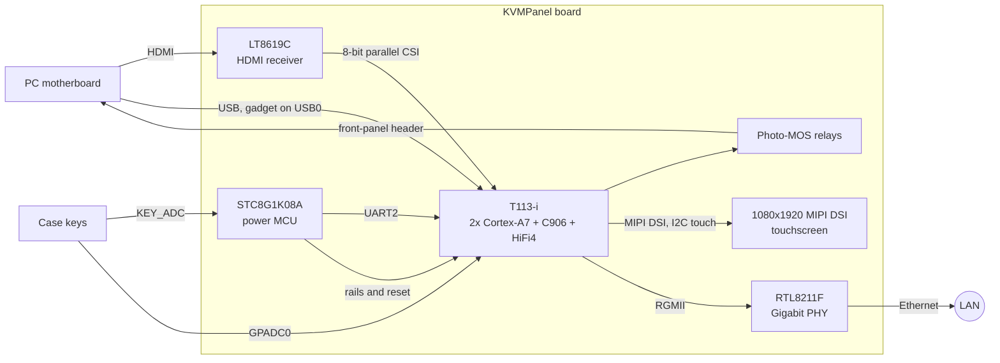
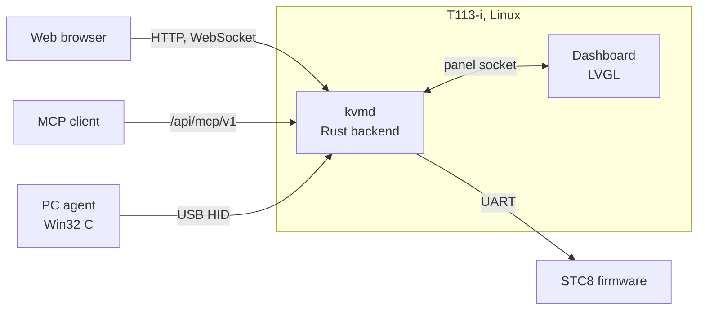

# KVMPanel

**English** | [简体中文](README.zh-CN.md)

KVMPanel is a board built around the Allwinner T113-i. It mounts in a PC case and does two jobs for that PC:

- **IP KVM**: view the screen and drive the keyboard and mouse from a browser, with power control, virtual media and file access over the network.
- **Case dashboard**: a touchscreen on the case that shows live CPU, GPU, memory and system stats sent by a program on the PC.

It also presses the motherboard's front-panel buttons (power, reset, BCLK+/−, safe boot) and offers an MCP server so AI agents can operate the PC through the KVM.

Hardware revision 2026-11-22. The software builds and passes simulator and QEMU tests; bring-up on a real board has not started yet.

## Features

| Area | What it does |
|---|---|
| Remote console | MJPEG video from HDMI capture (up to 1080p30), USB keyboard and absolute/relative mouse, paste as typing, keyboard layouts US/UK/DE |
| Media and files | Virtual CD/disk images, a shared disk the PC can read and write, file manager, URL downloads |
| Board tools | Web terminal, serial console, network, HTTPS, users and permissions, app updates with automatic rollback |
| PC control | Power and reset through photo-MOS relays, power LED sensing, Wake-on-LAN, BIOS and boot-menu key tapping |
| AI access | MCP over Streamable HTTP with scoped API keys, two-step confirmation for destructive actions, audit log and emergency stop |
| Dashboard | 1080×1920 touchscreen with LVGL UI, automatic backlight, four orientations, settings shared with the web UI |
| PC agent | Windows tray app that collects telemetry and offers an optional host channel (window info, clipboard, eject) over USB HID |
| Case keys | FUNC, BCLK+ and BCLK− keys on one resistor ladder, read by both the power MCU and the T113 |

## Hardware architecture

| Block | Parts and wiring |
|---|---|
| SoC | Allwinner T113-i: dual Cortex-A7, XuanTie C906 RISC-V core, HiFi4 DSP |
| Memory and storage | One DDR3 chip, 512 MB; microSD for the system, data and images |
| HDMI capture | LT8619C converts HDMI to 8-bit parallel video into the T113 CSI; 1080p30 maximum |
| USB | USB0 is the gadget to the PC (Type-C and an internal header): keyboard, mouse, storage, network, serial and the telemetry HID. The controller has five IN and five OUT endpoints in total, so the USB functions share that budget. USB1 is a USB-A host port. |
| Display | MIPI DSI panel (TD4322 driver) with touch and SGM3851A bias supply; BH1750 ambient light sensor for backlight control |
| Network | RTL8211F Gigabit Ethernet over RGMII |
| Power | TPS2116 picks the motherboard 5 V or an auxiliary 5 V. The STC8G1K08A MCU switches the main rail and the PD domain, holds the T113 in reset, and powers the board on or off with a two-key gesture. It talks to the T113 over UART2. |
| PC front panel | GAQY212GSX photo-MOS relays for power, reset, BCLK+, BCLK− and safe boot; power LED input; HDD LED passed through |
| Other | Four WS2812B LEDs; CH343K USB serial for the debug console |

Schematics, netlist and the pin allocation are in [hardware/](hardware/README.md).

## Software architecture

| Part | Language and role |
|---|---|
| [kvmd](software/app/ipkvm/README.md) | Rust (axum, tokio). Video capture and encoding, HID, USB gadget setup, GPIO, media, files, terminal, configuration, updates and the MCP server. Serves the web UI. |
| [Web UI](software/app/web/) | React and TypeScript. Remote console plus a settings window for the whole board. |
| [API contract](software/app/api/) | OpenAPI and JSON schemas for the HTTP, WebSocket and panel socket messages, with a mock server for frontend work. |
| [Dashboard](software/app/dashboard/README.md) | C and LVGL 9 on the Linux framebuffer. A separate process that talks to kvmd over a local Unix socket. |
| [PC agent](software/app/pc-telemetry/README.md) | Native Win32 C. Samples hardware sensors and sends them over a vendor HID report; also runs the optional host channel. |
| [STC8 firmware](software/firmware/stc8/README.md) | C for SDCC. Power sequencing, power key gestures, shutdown handshake and in-system updates from the T113. |
| [AMP firmware](software/firmware/t113-amp/) | Bring-up firmware for the C906 and HiFi4 cores through remoteproc and RPMsg. |
| [OS](software/os/README.md) | Linux 6.18 with board device trees and patches, U-Boot, a Debian 13 armhf SD image, and a Buildroot initramfs for USB FEL diagnostics. |

Board settings live in one configuration shared by the web UI and the dashboard; a change in either place shows up in the other. `kvmd --sim` runs the whole backend on a Linux PC or WSL without the board.

## Repository layout

| Path | Contents |
|---|---|
| `hardware/` | EDA exports, pin allocation and reference documents |
| `software/app/` | kvmd, web UI, API contract, dashboard and PC agent |
| `software/os/` | Kernel, U-Boot, Debian and Buildroot configuration, device trees and patches |
| `software/firmware/` | STC8 power MCU and T113 AMP firmware |
| `docs/` | Development notes, board bring-up notes, designs and progress |
| `sources/` | Notes on where upstream sources are kept; the sources themselves are not in this repository |

## Documentation

Detailed documentation is written in Chinese.

- [Development and builds](docs/development.md)
- [Linux 6.18 board bring-up notes](docs/linux-6.18.md)
- [Software progress](docs/software-progress.md)
- [App design](docs/superpowers/specs/2026-11-20-kvmpanel-app-design.md), [MCP design](docs/superpowers/specs/2026-11-23-mcp-design.md), [PC telemetry design](docs/superpowers/specs/2026-11-23-pc-telemetry-design.md)
- [Debian image](software/os/debian/README.md)
