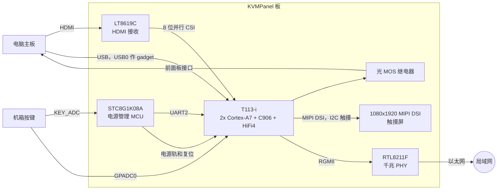
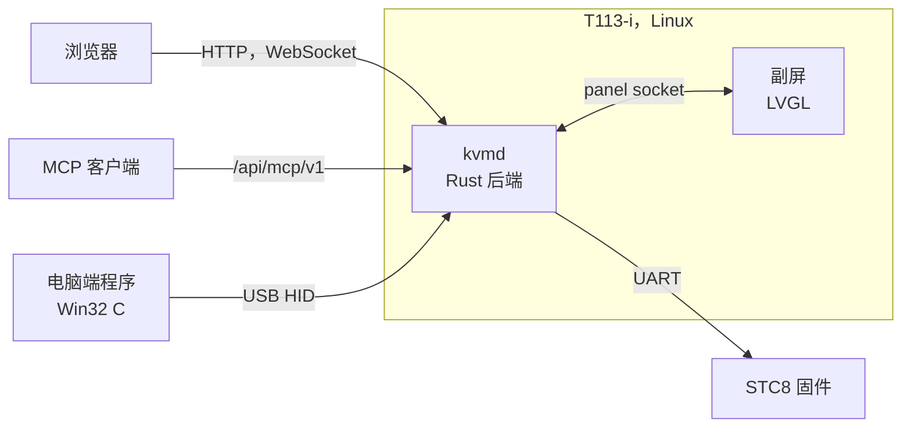

# KVMPanel

[English](README.md) | **简体中文**

KVMPanel 是一块基于全志 T113-i 的板子，装在电脑机箱上，为这台电脑做两件事：

- **IP KVM**：在浏览器里看画面、操作键鼠，并通过网络控制电源、挂载虚拟介质和管理文件。
- **机箱副屏**：机箱上的一块触摸屏，实时显示电脑上的程序发来的 CPU、GPU、内存和系统状态。

它还能按下主板前面板的按键（电源、复位、BCLK+/−、安全启动），并提供 MCP 服务，让 AI 代理通过 KVM 操作电脑。

硬件版本 2026-11-22。软件已能构建，并通过了模拟器和 QEMU 测试，实板调试尚未开始。

## 功能

| 方面 | 内容 |
|---|---|
| 远程控制台 | HDMI 采集的 MJPEG 视频（最高 1080p30），USB 键盘及绝对、相对鼠标，粘贴转键入，支持 US、UK、DE 键盘布局 |
| 介质和文件 | 虚拟光盘和磁盘镜像，电脑可读写的共享盘，文件管理，URL 下载 |
| 板子工具 | 网页终端、串口控制台、网络、HTTPS、用户和权限，带自动回滚的应用升级 |
| 电脑控制 | 经光 MOS 继电器控制电源和复位，读取电源灯，网络唤醒，连按进入 BIOS 和启动菜单 |
| AI 接入 | 基于 Streamable HTTP 的 MCP，分权限的 API key，危险操作两步确认，操作日志和急停 |
| 副屏 | 1080×1920 触摸屏，LVGL 界面，自动背光，四个方向，设置与网页共用 |
| 电脑端程序 | Windows 托盘程序，采集遥测，并可经 USB HID 提供可选的主机通道（窗口信息、剪贴板、弹出共享盘） |
| 机箱按键 | FUNC、BCLK+、BCLK− 共用一条电阻分压网络，电源管理 MCU 和 T113 都会读取 |

## 硬件架构

| 模块 | 器件和接线 |
|---|---|
| SoC | 全志 T113-i：双核 Cortex-A7、玄铁 C906 RISC-V 核、HiFi4 DSP |
| 内存和存储 | 单颗 DDR3，512 MB；microSD 存放系统、数据和镜像 |
| HDMI 采集 | LT8619C 把 HDMI 转成 8 位并行视频，接入 T113 的 CSI；最高 1080p30 |
| USB | USB0 作为 gadget 接电脑（Type-C 和板内插针），提供键盘、鼠标、存储、网络、串口和遥测 HID。控制器一共只有 5 个 IN 和 5 个 OUT 端点，各项 USB 功能共用这份预算。USB1 是 USB-A 主机口。 |
| 显示 | MIPI DSI 屏（TD4322 驱动）带触摸，SGM3851A 供偏压；BH1750 光线传感器用于背光调节 |
| 网络 | RTL8211F 千兆以太网，RGMII 接口 |
| 电源 | TPS2116 在主板 5 V 和辅助 5 V 之间选择。STC8G1K08A 控制主电源轨和 PD 域，控制 T113 复位，并用双键手势开关板子。它通过 UART2 与 T113 通信。 |
| 电脑前面板 | GAQY212GSX 光 MOS 继电器控制电源、复位、BCLK+、BCLK− 和安全启动；读取电源灯；HDD 灯直通 |
| 其他 | 四颗 WS2812B 灯珠；CH343K USB 串口用于调试控制台 |

原理图、网表和引脚分配见 [hardware/](hardware/README.md)。

## 软件架构

| 部分 | 语言和职责 |
|---|---|
| [kvmd](software/app/ipkvm/README.md) | Rust（axum、tokio）。负责视频采集和编码、HID、USB gadget 配置、GPIO、介质、文件、终端、配置、升级和 MCP 服务，同时提供网页文件。 |
| [网页](software/app/web/) | React 和 TypeScript。远程控制台，以及管理整块板子的设置窗口。 |
| [接口契约](software/app/api/) | HTTP、WebSocket 和 panel socket 消息的 OpenAPI 与 JSON Schema，附带供前端开发用的 mock 服务。 |
| [副屏](software/app/dashboard/README.md) | C 和 LVGL 9，运行在 Linux framebuffer 上。独立进程，通过本地 Unix socket 与 kvmd 通信。 |
| [电脑端程序](software/app/pc-telemetry/README.md) | 原生 Win32 C。采集硬件传感器，经厂商 HID 报告发送，同时运行可选的主机通道。 |
| [STC8 固件](software/firmware/stc8/README.md) | SDCC 下的 C。负责上电时序、电源键手势、关机握手，以及由 T113 发起的在线升级。 |
| [AMP 固件](software/firmware/t113-amp/) | C906 和 HiFi4 核的启动固件，经 remoteproc 和 RPMsg 通信。 |
| [系统](software/os/README.md) | Linux 6.18 加本板设备树和补丁、U-Boot、Debian 13 armhf SD 镜像，以及用于 USB FEL 诊断的 Buildroot initramfs。 |

网页和副屏共用同一份板子配置，任一处修改都会同步到另一处。`kvmd --sim` 可以在 Linux 电脑或 WSL 上不接板子运行整个后端。

## 目录

| 路径 | 内容 |
|---|---|
| `hardware/` | EDA 导出、引脚分配和参考资料 |
| `software/app/` | kvmd、网页、接口契约、副屏和电脑端程序 |
| `software/os/` | 内核、U-Boot、Debian 和 Buildroot 的配置、设备树和补丁 |
| `software/firmware/` | STC8 电源管理 MCU 和 T113 AMP 固件 |
| `docs/` | 开发说明、板级适配笔记、设计文档和进度 |
| `sources/` | 上游源码的存放说明；源码本身不在这个仓库里 |

## 文档

- [开发与构建](docs/development.md)
- [Linux 6.18 板级适配笔记](docs/linux-6.18.md)
- [软件进度](docs/software-progress.md)
- [应用设计](docs/superpowers/specs/2026-11-20-kvmpanel-app-design.md)、[MCP 设计](docs/superpowers/specs/2026-11-23-mcp-design.md)、[电脑遥测设计](docs/superpowers/specs/2026-11-23-pc-telemetry-design.md)
- [Debian 镜像](software/os/debian/README.md)
